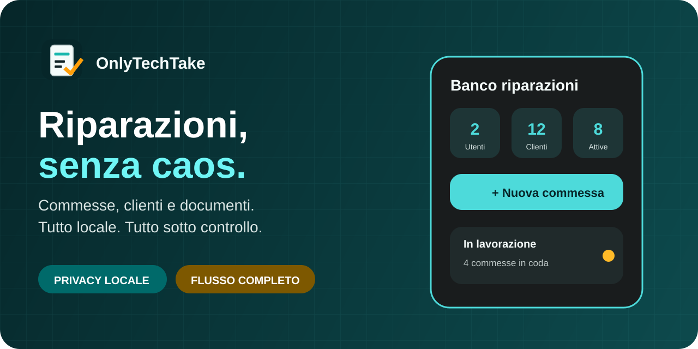

# OnlyTechTake: Un'app per ogni problema! 🛠️

[](https://developer.android.com)
[](https://kotlinlang.org)
[](https://developer.android.com/jetpack/compose)
[](https://www.zetetic.net/sqlcipher/)

Benvenuti in **OnlyTechTake**, la soluzione definitiva per la gestione delle commesse di riparazione. Nata per trasformare il caos dei fogli di carta in un flusso di lavoro digitale, sicuro e orientato al cliente.

> **"Un'app per ogni problema!"** — Dalla presa in carico alla consegna, OnlyTechTake è al tuo fianco.



## ✨ Perché scegliere OnlyTechTake?

OnlyTechTake non è solo un software di gestione; è la tua vetrina operativa. Progettata per laboratori tecnici e centri riparazione che vogliono offrire trasparenza e professionalità.

*   **🔒 Local-First & Privacy-By-Design**: I tuoi dati (e quelli dei tuoi clienti) non lasciano mai il dispositivo. Database cifrato con **SQLCipher** per la massima sicurezza.
*   **📱 Integrazione WhatsApp**: Comunica istantaneamente l'avanzamento della riparazione. L'app prepara il messaggio, tu premi invio.
*   **📸 Documentazione Multimediale**: Scatta foto prima e dopo la riparazione, cattura firme digitali e allega documenti tecnici.
*   **🧩 Versatile e Modulare**:
    *   **Pro**: L'esperienza completa senza limiti.
    *   **Demo**: Per provare le potenzialità con una sola commessa.
    *   **Showcase**: La nostra vetrina interattiva con dati pre-caricati per dimostrazioni veloci.

## 🚀 Funzionalità Chiave

*   **Workflow Guidato**: Un percorso a step che ti porta dalla diagnosi al preventivo, fino alla chiusura della commessa.
*   **Gestione Clienti Evoluta**: Database anagrafico completo per privati e aziende.
*   **Backup & Sicurezza**: Esporta i tuoi dati in formato ZIP cifrato o XLSX per la tua contabilità.
*   **Dashboard Operativa**: Tieni d'occhio le code: banco, diagnosi, riparazione e pronte per la consegna.

---

## 🛠️ Note Tecniche per lo Sviluppo

### Ambiente
*   **OS**: Windows 11 + PowerShell.
*   **Stack**: Kotlin, Compose, Material 3, Room, CameraX, Coroutines.
*   **SDK**: Target 37, Min 26.

### Setup Rapido
```powershell
# Verifica ambiente
powershell -ExecutionPolicy Bypass -File scripts\powershell\android\check_env.ps1

# Build e avvio (Flavor Full Debug)
powershell -ExecutionPolicy Bypass -File scripts\powershell\android\start_app.ps1 -CleanInstall
```

## 📖 Documentazione Completa
Consulta la nostra [Wiki interna](docs/README.md) per guide dettagliate su architettura, modelli dati e workflow di rilascio.

---

*OnlyTechTake è un prodotto local-only. Nessun cloud, nessuna dipendenza esterna, solo pura efficienza sul tuo dispositivo.*
