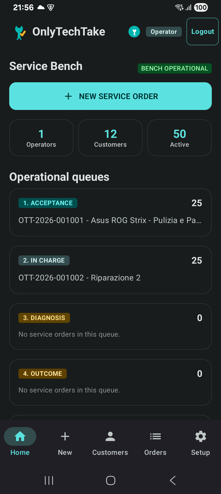
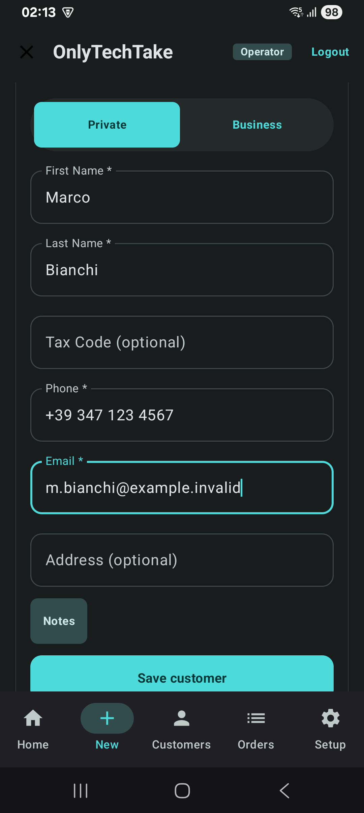
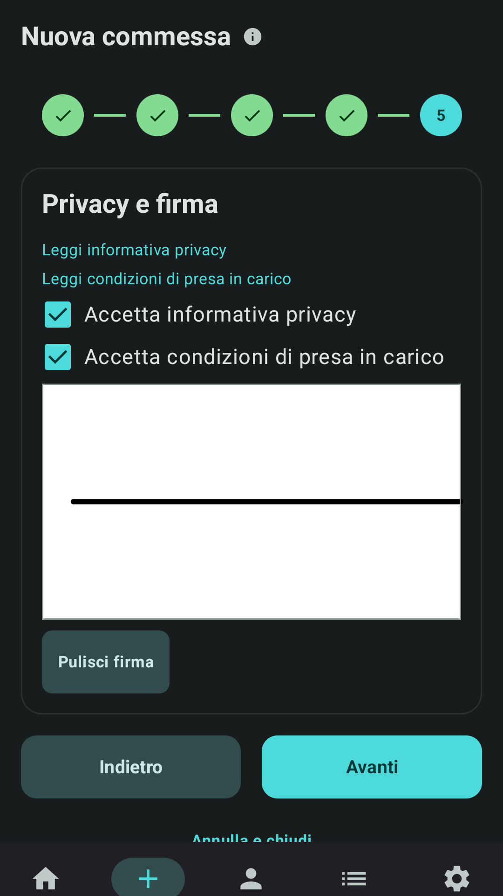
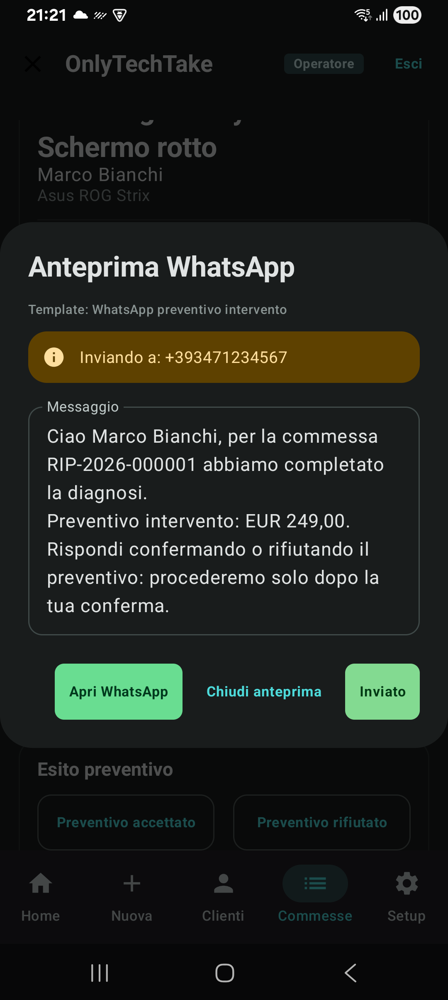

<p align="center">
  
</p>

# OnlyTechTake Repair App

<p align="center">
  
</p>

<p align="center">
  <a href="https://android.com"></a>
  <a href="https://kotlinlang.org"></a>
  <a href="https://developer.android.com/jetpack/compose"></a>
  
</p>

---

## 📱 Overview

**OnlyTechTake** is the ultimate local-first management solution for smartphone and PC repair labs. Designed for maximum privacy and speed, the app handles the entire lifecycle of repair orders without ever sending sensitive data to the cloud.

The app uses **English** as the default fallback language and includes full localization in **Italian**.

### ✨ Key Features
- 🛠️ **Order Management**: Real-time tracking (Open, Diagnosis, In Progress, Ready, Closed) with expanded operator permissions for full technical autonomy.
- 👤 **Customer CRM**: Local database optimized for quick search and repair history.
- ✍️ **Digital Signature**: Legal signature capture for terms and privacy acceptance directly on screen.
- 📸 **Media Documentation**: Photo attachments of device status integrated into the order.
- 📄 **PDF Reports**: Instant generation of intake forms and status receipts.
- 🔄 **Smart Templates**: WhatsApp and legal templates that auto-switch language (English/Italian) unless customized by the user.
- 🔐 **Total Privacy**: SQLCipher encrypted database and offline storage.
- 🌐 **Multi-language**: Native support for English (Default) and Italian.

---

## 🖼️ Visual Showcase

### Screenshots (Pro Version)
<p align="center">
  
  
  
  
</p>

### 🎥 Video Demo
[▶️ Watch the Full Workflow](marketing/videos/play-store/pro-workflow.mp4)

---

## 🌐 Landing Page & Presence

The project includes a modern and responsive landing page located in `/landing`.
- **Technologies**: HTML5, CSS3 (Modern Material 3 Design), Lucide Icons.
- **Features**: Interactive gallery, Dark/Light mode toggle, mobile optimization.
- **Local URL**: Open `landing/index.html` in your browser.

---

## 📊 Project Metrics & Status

| Metric | Value |
|:---|:---|
| **Target SDK** | 37 |
| **Min SDK** | 26 (Android 8.0) |
| **Architecture** | Clean Architecture / MVI |
| **Database** | SQLCipher v4 (Encrypted) |
| **Build Flavors** | `full`, `demo`, `showcase` |
| **Localization** | 🇺🇸 English (Default), 🇮🇹 Italian |
| **Status** | 🟢 Production Ready (v1.1.0) |

---

## 🛠️ Tech Stack
- **Language**: [Kotlin](https://kotlinlang.org/)
- **UI Framework**: [Jetpack Compose](https://developer.android.com/jetpack/compose)
- **Local Storage**: [Room](https://developer.android.com/training/data-storage/room) + [SQLCipher](https://www.zetetic.net/sqlcipher/)
- **Asynchrony**: Coroutines & Flow
- **Dependency Injection**: Manual DI (Container Pattern)
- **Media**: CameraX & ImagePicker

---

## 🚀 Local Development

The environment is optimized for **Windows 11 + PowerShell**.

```powershell
# 1. Verify development environment
./scripts/powershell/android/check_env.ps1

# 2. Run quality checks (Lint + Tests)
./scripts/powershell/project/quality.ps1

# 3. Build Pro version
./scripts/powershell/project/check_project.ps1 -Flavor Full -SkipReleaseBuild
```

For AI agent operational guidelines, see [AGENTS.md](AGENTS.md).

---

<p align="center">
  OnlyTechTake © 2026 | <a href="https://github.com/dennidalpos">GitHub Repo</a>
</p>
